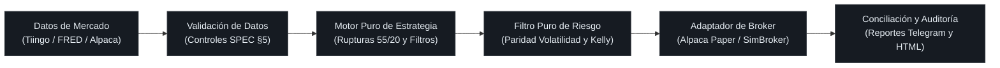
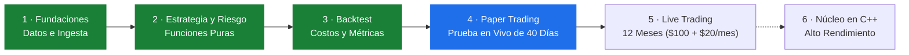

<a id="top"></a>

<p align="center">
  
</p>

<p align="center">
  
</p>

<p align="center">
  <a href="https://github.com/JAbarca74/stride/actions/workflows/ci.yml"></a>
  <a href="https://github.com/JAbarca74/stride/actions/workflows/security.yml"></a>
  
  <a href="https://github.com/astral-sh/ruff"></a>
  
  
  <a href="https://github.com/JAbarca74/stride/blob/main/LICENSE"></a>
  <a href="https://github.com/JAbarca74/stride/stargazers"></a>
  <a href="https://github.com/JAbarca74/stride/network/members"></a>
  <a href="https://github.com/JAbarca74/stride/pulls"></a>
</p>

<p align="center">
  <b>Sistema de seguimiento de tendencias sistemático de grado institucional con dimensionamiento por volatilidad, apalancamiento Kelly dinámico y frenos automáticos de emergencia.</b><br>
  Construido con algoritmos en funciones puras, cero sesgo de anticipación (look-ahead) y gestión cuantitativa del riesgo.
</p>

<p align="center">
  <a href="README.md">English</a> • <b>Español</b>
</p>

<p align="center">
  <a href="#por-qué-stride">¿Por qué STRIDE?</a> •
  <a href="#pilares-algorítmicos">Núcleo Algorítmico</a> •
  <a href="#flujo-de-una-jornada-de-trading">Arquitectura</a> •
  <a href="#riesgo-con-frenos-de-emergencia">Riesgo y Frenos</a> •
  <a href="#fase-4-paper-trading-y-veredicto">Fase 4</a> •
  <a href="#inicio-rápido">Inicio Rápido</a> •
  <a href="#hoja-de-ruta">Hoja de Ruta</a> •
  <a href="#historial-de-estrellas">Historial de Estrellas</a> •
  <a href="#contribuciones">Contribuciones</a>
</p>

<p align="center">
  <sub>⭐ <b>Si encuentras a STRIDE útil o inspirador para tu investigación cuantitativa, ¡apóyanos dejando una estrella en GitHub!</b> Ayuda a dar visibilidad y mantener activo el proyecto.</sub>
</p>


## ¿Por qué STRIDE?

La mayoría de los bots de trading de código abierto sufren de fallos críticos: **sesgo de anticipación (look-ahead bias)**, **apalancamiento descontrolado**, **credenciales en texto plano** o **ausencia de frenos de emergencia**. STRIDE está diseñado desde cero con estándares cuantitativos institucionales:

| Característica | Scripts Tradicionales | Frameworks Cuantitativos Antiguos | **STRIDE** |
| :-- | :-- | :-- | :-- |
| **Sesgo de Anticipación** | Frecuente (filtración involuntaria de datos futuros) | Mitigado mediante motores complejos con estado mutable | **Garantía Cero Look-Ahead**: Núcleo 100% de funciones puras con tests de propiedades matemáticas que verifican la ausencia de datos futuros |
| **Gestión de Riesgo** | Lotes fijos o porcentajes ingenuos | Wrappers complejos de portafolio | **Paridad de Volatilidad ($1N$ ATR)** que iguala el riesgo en dólares entre las 8 clases de activos |
| **Motor de Apalancamiento** | Fijo o margen de broker descontrolado | Multiplicadores estáticos | **Mínimo Dinámico de 5 Límites**: Kelly fraccional, objetivo de volatilidad, tope de apalancamiento, límite de broker y límite de capital |
| **Frenos de Emergencia** | Inexistentes (quiebran cuentas en caídas repentinas) | Scripts manuales o externos | **Sistema de Doble Freno**: Desapalancamiento automático al $-20\%$ + Liquidación de emergencia en broker al $-40\%$ |
| **Sincronización con Broker** | Se asume precisa sin verificar | Conciliación periódica | **Halt por Doble Jornada**: Congela operaciones de forma segura si la contabilidad local difiere del broker 2 días seguidos |
| **Tipado y Calidad** | Sin tipos, sin linter | Tipado parcial | **`mypy --strict`**, **Ruff**, **791 tests automáticos**, pruebas de propiedades invariantes con Hypothesis |
| **Seguridad de Secretos** | Texto plano en código o logs | Archivos de configuración expuestos | **Pydantic `SecretStr`**: Cero secretos registrados, impresos o comiteados; auditoría CI continua |
| **Automatización Diaria** | Clics manuales o bucles frágiles | Servicios pesados complejos | **Ciclo diario de 4 fases auto-contenido**: Programador de Tareas de Windows / cron en Linux con reportes ejecutivos vía Telegram |


## Pilares Algorítmicos

<p align="center">
  
</p>

STRIDE evalúa un universo diversificado de ETFs **una sola vez por día hábil**, ejecutando órdenes únicamente ante cambios en las señales. Sus reglas condensan décadas de investigación empírica:

| Concepto Cuantitativo | Origen Clásico | Implementación en STRIDE |
| :-- | :-- | :-- |
| **Rupturas de 55/20 Días y Piramidación** | Richard Dennis y William Eckhardt (The Turtles) | `ENTRY_HH55` (entrada en máximos de 55 días), `EXIT_LL20` (salida en mínimos de 20 días), `PYRAMID` (adición de unidades tras ganar $+1N$) |
| **Filtro de Régimen de Tendencia** | Paul Tudor Jones | `TREND_FILTER` (filtro SMA 200: solo se permiten posiciones largas cuando el precio supera la media móvil de 200 días) |
| **Asignación por Volatilidad** | Ray Dalio (Risk Parity) | $1\%$ del capital en riesgo por cada $1N$ de True Range de volatilidad |
| **Stop Trailing por Volatilidad** | Ed Seykota | `STOP_2N` (stop dinámico situado a $2N$ por debajo del punto de entrada o máximo alcanzado) |
| **Dimensionamiento Fraccional Fijo** | Larry Hite | El tamaño de la posición proviene estrictamente del riesgo de volatilidad, nunca de la convicción emocional |
| **Apalancamiento de Teoría de la Información** | J. L. Kelly Jr. / Ed Thorp | Criterio de Kelly acotado dinámicamente para eliminar el riesgo de ruina matemática |

<details>
<summary><b>Universo de Activos: 10 ETFs en 8 Clases Macro (Clic para desplegar)</b></summary>

<br>

STRIDE opera 10 instrumentos líquidos seleccionados para maximizar la diversificación entre regímenes económicos:

| Clase de Activo | Ticker | Descripción | Rol Económico |
| :-- | :-- | :-- | :-- |
| **Renta Variable EE.UU.** | `SPY` | SPDR S&amp;P 500 ETF Trust | Crecimiento y beneficios corporativos domésticos |
| **Renta Variable Internacional** | `EFA` | iShares MSCI EAFE ETF | Diversificación en mercados desarrollados globales |
| **Bonos del Tesoro EE.UU. (Medio Plazo)** | `IEF` | iShares 7-10 Year Treasury Bond | Refugio y amortiguación de duración |
| **Bonos del Tesoro EE.UU. (Largo Plazo)** | `TLT` | iShares 20+ Year Treasury Bond | Cobertura ante desinflación y crisis alpha |
| **Metales Preciosos (Oro)** | `GLD` | SPDR Gold Shares | Cobertura contra envilecimiento monetario y geopolítica |
| **Metales Preciosos (Plata)** | `SLV` | iShares Silver Trust | Híbrido industrial y monetario |
| **Materias Primas Amplias** | `DBC` | Invesco DB Commodity Index Tracking Fund | Protección contra inflación (energía, agricultura, metales) |
| **Dólar Estadounidense** | `UUP` | Invesco DB US Dollar Index Bullish Fund | Cobertura en crisis de liquidez global |
| **Oro Digital** | `IBIT` | iShares Bitcoin Trust | Reserva emergente de valor digital macro |
| **Plataforma Digital** | `ETHA` | iShares Ethereum Trust | Exposición a redes descentralizadas y contratos inteligentes |

</details>


## Flujo de una Jornada de Trading

<p align="center">
  
</p>

STRIDE impone una **tubería de datos estrictamente unidireccional**. Las capas de estrategia y riesgo están diseñadas como **funciones puras**:
- **Sin llamadas de red** dentro de la lógica de toma de decisiones.
- **Sin lecturas ni escrituras en disco** en el cálculo de señales.
- **Sin consultas al reloj del sistema** (el tiempo se suministra como una fecha inmutable).



Esta arquitectura funcional elimina cualquier fuga de datos futuros, asegura el determinismo matemático y permite reproducir cualquier estado histórico en pruebas unitarias de submilisegundos.


## Riesgo, con Frenos de Emergencia

### Formulación Cuantitativa del Apalancamiento

<p align="center">
  
</p>

El apalancamiento del portafolio se reevalúa cada día hábil como el mínimo matemático de cinco límites independientes:

$$\text{Apalancamiento}_{\text{efectivo}} = \min \left( L_{\text{Kelly}},\, L_{\text{vol\_target}},\, L_{\text{tope\_absoluto}},\, L_{\text{broker}},\, L_{\text{capital}} \right)$$

1. **Límite Kelly ($L_{\text{Kelly}}$)**: Fracción acotada según tasa de acierto y ratio de pago histórico para maximizar el crecimiento geométrico sin riesgo de cola.
2. **Objetivo de Volatilidad ($L_{\text{vol\_target}}$)**: Modula la exposición bruta inversamente a la volatilidad reciente del mercado.
3. **Tope Absoluto ($L_{\text{tope\_absoluto}}$)**: Techo máximo de $\le 4.0\text{x}$ (por defecto conservador $1.5\text{x}-2.0\text{x}$).
4. **Límite de Broker ($L_{\text{broker}}$)**: Bounded estrictamente por las restricciones de poder de compra del broker.
5. **Límite de Capital ($L_{\text{capital}}$)**: El endeudamiento por margen está desactivado (`allow_margin: false`); la exposición adicional proviene exclusivamente de ETFs apalancados 2x/3x, asegurando que la pérdida máxima esté limitada al capital depositado.

---

### Sistema de Doble Freno y Conciliación

<p align="center">
  
</p>

STRIDE cuenta con dos mecanismos de seguridad automatizados para proteger el capital contra eventos extremos y fallos operacionales:

| Disparador de Seguridad | Umbral | Acción Automática | Mecanismo de Recuperación |
| :-- | :-- | :-- | :-- |
| **Freno de Desapalancamiento** | **$-20\%$ Drawdown** | El apalancamiento efectivo se reduce de inmediato a la **mitad** en posiciones vigentes y nuevas | Permanece a medio apalancamiento hasta que el capital alcance un nuevo máximo histórico |
| **Kill Switch de Emergencia** | **$-40\%$ Drawdown** | Cancela todas las órdenes pendientes y **liquida la totalidad de las posiciones** en la siguiente apertura bursátil según los datos del broker. Crea el archivo centinela `KILL_SWITCH` y se detiene | Requiere intervención humana, análisis de causa raíz y reinicio explícito vía CLI |
| **Ruptura de Conciliación** | **2 Días Consecutivos** | **Congelación (Halt)**: Suspende la generación de nuevas órdenes manteniendo las posiciones existentes para evitar liquidaciones a ciegas ante cortes de red | Requiere conciliación manual de saldos mediante el comando `resolve-halt` |

---

### Seguridad por Diseño

- 🛡️ **Sin Dinero Real por Accidente**: `mode: live` requiere la variable `LIVE_CONFIRM=I_UNDERSTAND_REAL_MONEY`; de lo contrario, el sistema arranca en modo paper.
- 🔑 **Pydantic `SecretStr`**: Todas las credenciales sensibles se aíslan para impedir que se filtren en logs, trazas de depuración o serializaciones.
- 🚫 **Bloqueo de Claves de Producción**: El corredor paper rechaza credenciales que no comiencen con el prefijo oficial de simulación de Alpaca.
- 🧪 **Pruebas Invariantes con Hypothesis**: Cálculos de apalancamiento, vetos de riesgo y frenos se someten a millones de combinaciones aleatorias en tests de propiedades.


## Fase 4: Paper Trading y Veredicto

<p align="center">
  
</p>

STRIDE está operando en **Fase 4 de Paper Trading** en dos instancias concurrentes (SPEC §12):
- **STRIDE B** (`config.paper_b.yaml`): Núcleo tecnológico en QQQ a 1.5x + manga de compras en caídas de cripto.
- **STRIDE DIP** (`config.paper_dip.yaml`): Núcleo en SPY + manga cripto.

### Evaluador Automático de Veredicto a 40 Días Bursátiles

Al completarse **40 días hábiles de negociación** registrados en la tabla `equity`, `Runner.evening()` ejecuta automáticamente el evaluador de veredicto final frente al índice $SPY$:

1. **Criterios de Rendimiento Frente al Benchmark**:
   - **Retorno Ponderado en el Tiempo**: El retorno acumulado (TWR) de la estrategia debe superar al de comprar y mantener $SPY$:
     $$\text{TWR}_{\text{STRIDE}} \ge \text{TWR}_{\text{SPY}}$$
   - **Retorno Ajustado por Riesgo**: El ratio de Sharpe anualizado debe igualar o superar al de $SPY$:
     $$\text{Sharpe}_{\text{STRIDE}} \ge \text{Sharpe}_{\text{SPY}}$$
2. **Limpieza Operacional**:
   - Cero eventos de `KILL_SWITCH`, `HALT` o `RECONCILIATION_BREAK` durante los 40 días.
   - Máximo drawdown pico a valle estrictamente inferior al **40%**.
3. **Notificación Automatizada**:
   - Envía una alerta prioritaria por Telegram y almacena un registro permanente `PHASE4_VERDICT` en la base de datos.
   - Veredicto positivo: `"EN HORABUENA YA ESTA LISTO Y EL RESULTADO ES POSITIVO"` con métricas completas.
   - Veredicto negativo: `"Buena prueba amigo, pero el syp500 es mejor"` con comparativa detallada.

### Consulta del Estado del Veredicto

Puedes consultar el progreso actual o forzar una evaluación en cualquier momento mediante la bandera `--verdict`:

```bash
# Consultar progreso o veredicto de la Instancia Paper B
python -m stride.reporting.daily --config config.paper_b.yaml --verdict

# Consultar progreso o veredicto de la Instancia Paper DIP
python -m stride.reporting.daily --config config.paper_dip.yaml --verdict
```


## Inicio Rápido

### 1. Clonar el Repositorio e Instalar

```bash
git clone https://github.com/JAbarca74/stride.git
cd stride

# Crear entorno virtual
python -m venv .venv

# Activar entorno virtual
# En macOS / Linux:
source .venv/bin/activate
# En Windows (PowerShell):
.venv\Scripts\Activate.ps1

# Instalar en modo editable con herramientas de desarrollo
pip install -e ".[dev]"
```

### 2. Ejecutar Pruebas (Completamente Offline)

Los 791 tests automatizados de STRIDE se ejecutan en segundos sin necesidad de claves ni conexión a red:

```bash
pytest
```

---

### 3. Cargar y Validar Datos de Mercado

Copia `.env.example` a `.env` y añade una clave gratuita de Tiingo y las claves paper de Alpaca:

```bash
cp .env.example .env

# Descargar o actualizar incrementalmente las 10 series de ETFs
stride-data prices            # o: python -m stride.data.update prices

# Ejecutar validaciones de integridad de SPEC sección 5
stride-data validate          # o: python -m stride.data.update validate

# Cotejar cierres gratuitos de Alpaca frente a Tiingo
stride-data check-alpaca      # o: python -m stride.data.update check-alpaca

# Calibrar ETFs apalancados sintéticos vs reales (SPEC §7 / T21)
stride-data t21               # o: python -m stride.data.update t21
```

---

### 4. Ejecutar Backtests Cuantitativos

Simula el comportamiento histórico desde 2007 hasta la actualidad con costes de transacción y deslizamiento realistas:

```bash
# Backtest estándar con apalancamiento Kelly dinámico ($100 de capital inicial)
python -m stride.backtest.run

# Comparativa de apalancamiento fijo (SPEC §9)
python -m stride.backtest.run --fixed-leverage 2

# Exportar reporte interactivo HTML de rendimiento
python -m stride.backtest.run --report reports/backtest.html

# Ejecutar protocolo institucional de validación y estabilidad de parámetros
python -m stride.backtest.validation
```

---

### 5. Automatización Diaria

`python -m stride.run_daily` gestiona la operativa a través de las 4 ventanas diarias en hora de Nueva York:

| Fase | Ventana (ET) | Propósito y Tareas |
| :-- | :-- | :-- |
| `evening` | 18:00 – 20:00 | Descarga de precios, avance del índice, revisión del kill switch, cálculo de pesos objetivo, aprobación de órdenes por riesgo, reporte en Telegram y veredicto de Fase 4 |
| `morning` | 09:15 – 09:30 | Envío de órdenes aprobadas al broker antes de la campana de apertura; en caso de kill switch, liquidación de emergencia |
| `midday` | 12:00 – 13:00 | Comprobación de estado de órdenes y ejecuciones parciales |
| `close` | 16:05 – 17:00 | Cancelación de órdenes pendientes, registro de ejecuciones y conciliación con el broker |
| `auto` | Continuo | Detecta automáticamente la fase activa del momento para integrarse con cron o el Programador de Tareas |

```bash
# Ejecutor de producción: detecta automáticamente la fase correspondiente
python -m stride.run_daily --config config.paper_b.yaml --phase auto

# Ejecutar una fase individual manualmente
python -m stride.run_daily --config config.paper_b.yaml --phase evening
```

<details>
<summary><b>Configuración en Servidor Linux 24/7 (Cron / Nube) (Clic para expandir)</b></summary>

<br>

Para automatizar STRIDE en un servidor 24/7 (ej. Ubuntu / Oracle Cloud Always Free VM):
1. Instala el cron job proporcionado:
   ```bash
   bash scripts/install_cron.sh
   ```
2. La tarea ejecuta `scripts/run_stride.sh` cada 15 minutos en modo `auto` cubriendo todas las fases del mercado bursátil y genera respaldos automáticos en `~/stride_backups/` mediante `scripts/backup_db.sh`.
3. Monitorizar logs en vivo:
   ```bash
   tail -f data/logs/scheduler.log
   ```

</details>

<details>
<summary><b>Configuración en Windows (Programador de Tareas) (Clic para expandir)</b></summary>

<br>

Para automatizar STRIDE localmente en Windows 10/11:
1. Abre PowerShell como Administrador y ejecuta:
   ```powershell
   powershell -ExecutionPolicy Bypass -File scripts\install_task.ps1
   Get-ScheduledTask -TaskName "STRIDE paper"
   ```
2. La tarea ejecuta `scripts\run_stride.ps1` cada 15 minutos con soporte de reactivación y respaldos automáticos en `~/Documents/stride_backups`.
3. Monitorizar logs en vivo:
   ```powershell
   Get-Content data\logs\scheduler.log -Tail 30
   ```

</details>


## Desarrollo y Calidad de Código

```bash
# Ejecutar suite de pruebas
pytest

# Comprobar formato y linting con Ruff
ruff check . && ruff format --check .

# Verificación estricta de tipos con mypy
mypy src tests

# Ejecutar hooks de pre-commit
pre-commit run --all-files
```

### Estructura del Repositorio

```text
stride/
├── config.yaml               # Configuración base de estrategia y riesgo
├── config.paper_b.yaml       # Configuración de Instancia Paper B (QQQ + dip)
├── config.paper_dip.yaml     # Configuración de Instancia Paper DIP (SPY + dip)
├── docs/                     # Especificaciones, arquitectura y diagramas
│   ├── SPEC.md               # Especificación técnica oficial (fuente de verdad)
│   ├── CONFIG.md             # Documentación exhaustiva de parámetros de config.yaml
│   └── assets/               # Diagramas vectoriales, animaciones SVG y previsualizaciones
├── src/stride/
│   ├── data/                 # Ingesta, validación y almacenamiento SQLite
│   ├── strategy/             # Señales puras (Turtles 55/20, SMA 200)
│   ├── risk/                 # Motor puro de riesgo (Kelly, paridad de volatilidad, frenos)
│   ├── execution/            # Adaptadores de broker (Alpaca paper, SimBroker)
│   ├── backtest/             # Motor event-driven de backtesting y métricas
│   ├── reporting/            # Reportes HTML, alertas Telegram y veredicto Fase 4
│   └── run_daily.py          # Orquestador del ciclo diario
├── tests/                    # 791 pruebas unitarias, de integración y de propiedades
└── scripts/                  # Scripts de automatización para Windows y Linux
```


## Hoja de Ruta

Cada fase debe satisfacer estrictamente sus criterios cuantitativos de salida antes de iniciar la siguiente:



| Fase | Hito | Criterio de Salida | Estado |
| :-- | :-- | :-- | :-- |
| **Fase 1** | Fundaciones | Datos de los 10 activos cargados (2007-presente) con 100% de validaciones SPEC §5 aprobadas | **Completada** ✅ |
| **Fase 2** | Estrategia y Riesgo | Cobertura de tests $\ge 90\%$ en `strategy/` y `risk/`, tests anti-look-ahead superados | **Completada** ✅ |
| **Fase 3** | Backtesting | Sharpe fuera de muestra superior al de $SPY$ y $\le 1.5$, análisis de sensibilidad estable | **Completada** ✅ |
| **Fase 4** | Paper Trading | 40 días bursátiles consecutivos sin errores, conciliación limpia, superando a $SPY$ | **En Curso** 🔄 (Evaluador activo) |
| **Fase 5** | Live Trading | 12 meses con capital real ($100 inicial + $20/mes de aportación); hipótesis evaluadas | Planificada ⏳ |
| **Fase 6** | Núcleo en C++ | Motor vectorizado en C++20 para backtesting masivo | Propuesta 💡 |


## Historial de Estrellas

Si valoras las herramientas financieras de código abierto con rigor cuantitativo, déjanos una estrella:

<p align="center">
  <a href="https://star-history.com/#JAbarca74/stride&amp;Date">
    
  </a>
</p>


## Contribuciones

¡Las contribuciones, reportes de incidencias y debates cuantitativos son bienvenidos!
Consulta [`CONTRIBUTING.md`](CONTRIBUTING.md) para más detalles.

## Seguridad

Las cuestiones de seguridad se gestionan de forma responsable. Si descubres una vulnerabilidad o sospechas de una credencial expuesta, repórtalo según se indica en [`SECURITY.md`](SECURITY.md).

## Citación

Si utilizas STRIDE en tu trabajo de investigación cuantitativa, por favor cítalo como:

```bibtex
@software{stride2026,
  author       = {Jefferson Abarca},
  title        = {STRIDE: Systematic Trend & Risk-Integrated Daily Execution},
  year         = {2026},
  url          = {https://github.com/JAbarca74/stride},
  version      = {0.1.0},
  license      = {MIT}
}
```

## Licencia

Este proyecto está bajo la [Licencia MIT](LICENSE).

## Aviso Legal

Este software se proporciona únicamente con fines educativos y de investigación cuantitativa. Nada de lo aquí expuesto constituye asesoramiento financiero, recomendación de inversión o invitación a operar. El trading algorítmico conlleva un riesgo sustancial de pérdida de capital, y los instrumentos apalancados amplifican la volatilidad. El autor y los colaboradores no asumen responsabilidad alguna por las pérdidas financieras derivadas del uso de este código.

<p align="right"><a href="#top">Volver arriba ↑</a></p>
