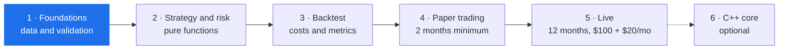

<a id="top"></a>

<p align="center">
  
</p>

<p align="center">
  
</p>

<p align="center">
  <a href="https://github.com/JAbarca74/stride/actions/workflows/ci.yml"></a>
  <a href="https://github.com/JAbarca74/stride/actions/workflows/security.yml"></a>
  
  <a href="https://github.com/astral-sh/ruff"></a>
  
  
  <a href="LICENSE"></a>
  <a href="https://github.com/JAbarca74/stride/stargazers"></a>
</p>

<p align="center">
  <b>A systematic trend-following trading system with volatility-based risk management,</b><br>
  built as a 12-month live experiment and an open technical portfolio project.
</p>

<p align="center">
  <a href="#features">Features</a> ·
  <a href="#how-a-trading-day-flows">How it works</a> ·
  <a href="#risk-with-brakes">Risk</a> ·
  <a href="#quick-start">Quick start</a> ·
  <a href="#roadmap">Roadmap</a> ·
  <a href="#contributing">Contributing</a>
</p>


## Features

<p align="center">
  
</p>

STRIDE evaluates a diversified ETF universe **once per trading day** and only trades when a signal changes. Its rules come from long-lived systematic traders:

| Rule | Source | In STRIDE |
| :-- | :-- | :-- |
| 55/20-day breakouts and pyramiding | The Turtles | `ENTRY_HH55`, `EXIT_LL20`, `PYRAMID` |
| 200-day trend filter | Paul Tudor Jones | `TREND_FILTER` |
| Risk-based allocation | Ray Dalio | 1% of equity per 1N of volatility |
| Volatility stops | Ed Seykota | `STOP_2N` |
| Fixed fractional risk | Larry Hite | position size from risk, not conviction |

<details>
<summary><b>The universe: 10 ETFs across 8 asset classes</b></summary>

<br>

| Asset class | ETFs |
| :-- | :-- |
| US equities | `SPY` |
| International equities | `EFA` |
| US Treasuries (mid, long) | `IEF`, `TLT` |
| Precious metals | `GLD`, `SLV` |
| Broad commodities | `DBC` |
| US dollar | `UUP` |
| Crypto | `IBIT` (bitcoin), `ETHA` (ether) |

</details>


## How a trading day flows

<p align="center">
  
</p>

Data flows one way. Strategy and risk are **pure functions** (no network, no file I/O, no clock), which makes them easy to test and impossible to leak future data into. Only the execution layer talks to a broker, and switching between backtest, paper and live is a single `mode` setting.


## Risk, with brakes

<p align="center">
  
</p>

Leverage is recomputed every day as the minimum of five limits, up to full Kelly and never above 4x. Below $2,000 there is no margin: extra exposure can only come from 2x/3x ETFs, so the maximum loss is the amount deposited.

<p align="center">
  
</p>

A drawdown past −20% halves leverage until a new high, and −40% trips a kill switch that closes every position and stops the system until a human resets it.

### Safety by design

| Area | Guarantee |
| :-- | :-- |
| Live trading | **No real money by accident.** `mode: live` only takes effect with `LIVE_CONFIRM=I_UNDERSTAND_REAL_MONEY`; otherwise STRIDE starts in paper mode. |
| Credentials | **Paper keys only in development.** Alpaca keys that are not paper keys are refused. |
| Secrets | **Secrets never leave `.env`.** Keys are read as `SecretStr`, never printed, logged or committed. CI scans every push for leaked secrets. |
| Data | **No look-ahead.** Rolling highs and lows exclude the current day, and a test checks that no function reads data dated after the evaluation date. |
| Testing | **Invariant tests for code that moves money.** Leverage, the risk veto and the kill switch are covered by property-based tests with Hypothesis. |


## Quick start

```bash
git clone https://github.com/JAbarca74/stride.git
cd stride
python -m venv .venv
# Windows: .venv\Scripts\activate   |   macOS/Linux: source .venv/bin/activate
pip install -e ".[dev]"
pytest                    # no network and no keys needed
```

<details>
<summary><b>Loading market data</b></summary>

<br>

Copy `.env.example` to `.env` and add a data-only key (Tiingo) and, optionally, **paper-trading** keys. Never put live-trading credentials in `.env`. Keys are read from `.env` and never printed. Downloads are incremental and cached in `data/stride.db`.

```bash
cp .env.example .env
python -m stride.data.update prices        # download or extend every series
python -m stride.data.update validate      # SPEC section 5 validations
python -m stride.data.update check-alpaca  # Alpaca free-plan closes vs Tiingo
python -m stride.data.update t21           # synthetic vs real leveraged ETFs
```

</details>

<details>
<summary><b>Running the backtest</b></summary>

<br>

Needs `data/stride.db` (above) and network access to FRED for the 3-month T-bill rate (no key). Results go to a separate database, never to `data/stride.db`, whose equity and risk-state tables belong to the paper or live account.

```bash
python -m stride.backtest.run                              # 2007 to the last stored day, $100 start
python -m stride.backtest.run --fixed-leverage 2           # leverage comparison (SPEC 9)
python -m stride.backtest.run --report reports/backtest.html
python -m stride.backtest.validation                       # SPEC 9 protocol -> docs/results/
```

</details>

<details>
<summary><b>Development checks</b></summary>

<br>

```bash
pip install -e ".[dev,alpaca]"
pytest
ruff check . && ruff format --check .
mypy src tests
```

</details>

<details>
<summary><b>Repository guide</b></summary>

<br>

| Path | Contents |
| :-- | :-- |
| `docs/SPEC.md` | Technical specification (source of truth) |
| `config.yaml` | Strategy and risk parameters |
| `src/stride/data/` | Downloads, validation, SQLite store |
| `src/stride/strategy/` | Indicators and trading rules (pure) |
| `src/stride/risk/` | Sizing, leverage, risk veto, kill switch (pure) |
| `src/stride/execution/` | Brokers: simulated and Alpaca paper |
| `src/stride/backtest/` | Backtest engine, costs and performance metrics |
| `src/stride/reporting/` | Reports, correlations, alerts |
| `tests/` | Test suite |
| `CLAUDE.md`, `AGENTS.md` | Rules for coding agents |

</details>


## Roadmap

No phase starts until the previous one meets its exit criterion. Real money enters only in Phase 5.



<details>
<summary><b>Exit criteria per phase</b></summary>

<br>

| Phase | Exit criterion |
| :-- | :-- |
| 1. Foundations | Data for the 10 assets loaded (from 2007; crypto from 2015) with every validation green |
| 2. Strategy and risk | Test coverage ≥ 90% in `strategy/` and `risk/`, anti-look-ahead test passing |
| 3. Backtest | Out-of-sample Sharpe above SPY's and below 1.5, stable sensitivity, documented results |
| 4. Paper trading | 40 consecutive trading days without failures, clean reconciliation, orders identical to the backtest |
| 5. Live | Hypotheses H1, H2 and H3 evaluated in the final report |

</details>


## Contributing

Issues and focused pull requests are welcome. Read [`CONTRIBUTING.md`](CONTRIBUTING.md) first; the risk, kill switch and broker modules are reviewed line by line. Please follow the [Code of Conduct](CODE_OF_CONDUCT.md).

If you find the project useful, starring the repository helps others discover it.

## Security

Found a vulnerability or something that looks like a leaked key? **Do not open a public issue.** Report it privately as described in [`SECURITY.md`](SECURITY.md).

## License

[MIT](LICENSE) © 2026 Jefferson Abarca

## Disclaimer

This is an educational research project. Nothing here is financial advice, a trading signal or a promise of returns. Trading involves risk of loss, and leverage increases it. Use the code at your own risk.

<p align="right"><a href="#top">Back to top ↑</a></p>
