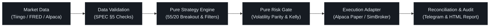
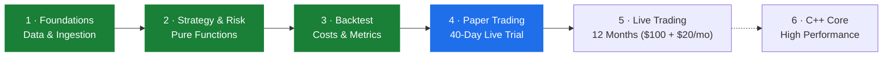

<a id="top"></a>
<!-- STRIDE: Production Quantitative Trend-Following & Risk System -->

<p align="center">
  
</p>

<p align="center">
  
</p>

<p align="center">
  <a href="https://github.com/JAbarca74/stride/actions/workflows/ci.yml"></a>
  <a href="https://github.com/JAbarca74/stride/actions/workflows/security.yml"></a>
  
  <a href="https://github.com/astral-sh/ruff"></a>
  
  
  <a href="https://github.com/JAbarca74/stride/blob/main/LICENSE"></a>
  <a href="https://github.com/JAbarca74/stride/stargazers"></a>
  <a href="https://github.com/JAbarca74/stride/network/members"></a>
  <a href="https://github.com/JAbarca74/stride/pulls"></a>
</p>

<p align="center">
  <b>Production-grade systematic trend-following system with quantitative volatility sizing, Kelly leverage bounding, and automated circuit breakers.</b><br>
  Built with pure functional algorithms, zero look-ahead bias, and institutional risk management.
</p>

<p align="center">
  <b>English</b> • <a href="README.es.md">Español</a>
</p>

<p align="center">
  <a href="#why-stride">Why STRIDE?</a> •
  <a href="#algorithmic-pillars">Algorithmic Core</a> •
  <a href="#how-a-trading-day-flows">Architecture</a> •
  <a href="#risk-with-brakes">Risk &amp; Brakes</a> •
  <a href="#phase-4-paper-trading--verdict">Phase 4 Trial</a> •
  <a href="#quick-start">Quick Start</a> •
  <a href="#roadmap">Roadmap</a> •
  <a href="#star-history">Star History</a> •
  <a href="#contributing">Contributing</a>
</p>

<p align="center">
  <sub>⭐ <b>If you find STRIDE insightful or useful for your quantitative research, consider giving it a star!</b> It helps the project grow and stay maintained.</sub>
</p>


## Why STRIDE?

Most open-source trading bots on GitHub suffer from critical flaws: **look-ahead bias**, **uncontrolled leverage**, **hard-coded credentials**, or **zero automated circuit breakers**. STRIDE is engineered from the ground up to address these failures with institutional quantitative standards:

| Feature | Naive Trading Scripts | Legacy Quant Frameworks | **STRIDE** |
| :-- | :-- | :-- | :-- |
| **Look-Ahead Bias** | Frequent (unintentional future leakage) | Mitigated via complex stateful engines | **Zero Look-Ahead Guarantee**: 100% pure functional core with property tests verifying no future bar access |
| **Risk Management** | Fixed lot or naive percentage size | Complex portfolio wrappers | **Volatility Parity ($1N$ ATR)** equalizes dollar risk across 8 asset classes |
| **Leverage Engine** | Fixed or uncontrolled broker margin | Static multiplier | **Dynamic 5-Limit Minimum**: Kelly bound, target volatility, leverage cap, broker cap, capital limit |
| **Emergency Circuit Breakers** | None (wipes accounts during gaps) | Manual or external scripts | **Dual-Brake System**: Automatic $-20\%$ de-leverage + automatic $-40\%$ emergency broker liquidation |
| **Broker Ledger Sync** | Assumed accurate | Periodic reconciliation | **Dual-Day Halt**: Freezes trading safely if local ledger diverges from broker on 2 consecutive days |
| **Type Safety & Quality** | Untyped, unlinted | Mixed typing | **`mypy --strict`**, **Ruff**, **791 automated tests**, Hypothesis property-based invariants |
| **Credential Security** | Plaintext in scripts or logs | Config files | **Pydantic `SecretStr`**: Zero secrets logged, printed, or committed; automated CI credential audits |
| **Live Automation** | Manual clicking or brittle loops | Heavy daemon infrastructure | **Self-contained 4-phase daily cycle**: Windows Task Scheduler / Linux cron with daily Telegram audit reports |


## Algorithmic Pillars

<p align="center">
  
</p>

STRIDE operates on an institutional ETF universe **once per trading day**, executing trades exclusively when signals transition. Its rules synthesize decades of empirical market research:

| Quantitative Concept | Classical Source | STRIDE Implementation |
| :-- | :-- | :-- |
| **55/20-Day Breakouts &amp; Pyramiding** | Richard Dennis &amp; William Eckhardt (The Turtles) | `ENTRY_HH55` (enter on 55-day breakout), `EXIT_LL20` (exit on 20-day low), `PYRAMID` (pyramid on $+1N$ gain) |
| **Long-Term Trend Regime Filter** | Paul Tudor Jones | `TREND_FILTER` (SMA 200 regime gate: long exposure permitted only when price &gt; SMA 200) |
| **Volatility Risk Allocation** | Ray Dalio (Risk Parity) | $1\%$ of equity allocated per $1N$ of True Range volatility |
| **Volatility Trailing Stop** | Ed Seykota | `STOP_2N` (trailing stop placed at $2N$ below entry/highest bar) |
| **Fixed Fractional Risk Sizing** | Larry Hite | Position sizing derived strictly from volatility risk, never emotional conviction |
| **Information-Theoretic Leverage** | J. L. Kelly Jr. / Ed Thorp | Kelly criterion fraction dynamically bounded to eliminate ruin risk |

<details>
<summary><b>Asset Universe: 10 ETFs Across 8 Macro Asset Classes (Click to expand)</b></summary>

<br>

STRIDE tracks 10 liquid instruments chosen to maximize cross-asset diversification across distinct economic regimes:

| Asset Class | Ticker | Description | Economic Role |
| :-- | :-- | :-- | :-- |
| **US Equities** | `SPY` | SPDR S&amp;P 500 ETF Trust | Domestic growth and corporate earnings |
| **International Equities** | `EFA` | iShares MSCI EAFE ETF | Global developed market diversification |
| **US Treasuries (Intermediate)** | `IEF` | iShares 7-10 Year Treasury Bond | Flight-to-safety &amp; duration cushion |
| **US Treasuries (Long)** | `TLT` | iShares 20+ Year Treasury Bond | Disinflation hedge &amp; crisis alpha |
| **Precious Metals (Gold)** | `GLD` | SPDR Gold Shares | Monetary debasement &amp; geopolitical hedge |
| **Precious Metals (Silver)** | `SLV` | iShares Silver Trust | Industrial &amp; precious metals hybrid |
| **Broad Commodities** | `DBC` | Invesco DB Commodity Index Tracking Fund | Inflation protection (energy, agriculture, metals) |
| **US Dollar** | `UUP` | Invesco DB US Dollar Index Bullish Fund | Global liquidity squeeze &amp; dollar surge hedge |
| **Digital Gold** | `IBIT` | iShares Bitcoin Trust | Emerging macro digital store of value |
| **Digital Platform** | `ETHA` | iShares Ethereum Trust | Smart-contract &amp; decentralized network exposure |

</details>


## How a Trading Day Flows

<p align="center">
  
</p>

STRIDE enforces a strict **unidirectional data pipeline**. Strategy and risk layers are written as **pure functions**:
- **No network calls** inside strategy logic.
- **No filesystem reads/writes** inside signal calculation.
- **No system clock references** (time is explicitly passed as an immutable trading date).



This functional architecture eliminates data snooping, ensures mathematical determinism, and allows any historical or edge-case state to be reproduced in sub-millisecond unit tests.


## Risk, with Brakes

### Quantitative Leverage Formulation

<p align="center">
  
</p>

Portfolio leverage is dynamically evaluated every trading day as the mathematical minimum of five independent limits:

$$\text{Leverage}_{\text{effective}} = \min \left( L_{\text{Kelly}},\, L_{\text{vol\_target}},\, L_{\text{absolute\_cap}},\, L_{\text{broker}},\, L_{\text{capital}} \right)$$

1. **Kelly Limit ($L_{\text{Kelly}}$)**: Bounded fraction based on historical win-rate and payoff ratio to maximize long-term geometric compounding without tail ruin.
2. **Volatility Target ($L_{\text{vol\_target}}$)**: Adjusts portfolio gross exposure inversely to current macro market volatility.
3. **Absolute Cap ($L_{\text{absolute\_cap}}$)**: Hard ceiling of $\le 4.0\text{x}$ (conservative default $1.5\text{x}-2.0\text{x}$).
4. **Broker Limit ($L_{\text{broker}}$)**: Strictly bounded by broker buying power restrictions.
5. **Capital Limit ($L_{\text{capital}}$)**: Margin borrowing is disabled (`allow_margin: false`); extra exposure is gained exclusively via structured leveraged ETFs, ensuring loss is strictly bounded by deposited capital.

---

### Dual-Brake Circuit Breakers &amp; Reconciliation

<p align="center">
  
</p>

STRIDE operates two automated safety brakes to safeguard capital against black-swan regimes and operational failure:

| Safety Trigger | Threshold | Automated Response | Recovery Mechanism |
| :-- | :-- | :-- | :-- |
| **De-Leverage Brake** | **$-20\%$ Drawdown** | Effective leverage is immediately **halved** across all current and new positions | Remains at half-leverage until portfolio equity establishes a new all-time high |
| **Emergency Kill Switch** | **$-40\%$ Drawdown** | Cancels all pending orders and **liquidates all positions** at the next market open using broker-reported holdings. Writes a `KILL_SWITCH` sentinel and halts execution | Requires human inspection, root-cause analysis, and explicit CLI reset confirmation |
| **Reconciliation Break** | **2 Consecutive Days** | **System Freeze (Halt)**: Suspends all order generation while keeping existing positions open to prevent blind liquidation on network glitches | Requires human resolution of ledger discrepancy via `resolve-halt` CLI |

> [!NOTE]
> The $-40\%$ kill switch is an automated stop-loss trigger executed at the next market open; extreme overnight market gaps can result in realized losses exceeding the trigger threshold.

---

### Security &amp; Safety by Design

- 🛡️ **Zero Real Money by Accident**: `mode: live` requires an explicit environment override `LIVE_CONFIRM=I_UNDERSTAND_REAL_MONEY`; otherwise STRIDE falls back safely to paper mode.
- 🔑 **Pydantic `SecretStr`**: All API tokens (Alpaca, Tiingo, Telegram) are encapsulated in secret containers that censor sensitive tokens from logs, stack traces, and serialization.
- 🚫 **Paper Credential Lock**: The paper runner rejects live Alpaca credentials to prevent accidental execution on live accounts during testing.
- 🧪 **Invariant Testing with Hypothesis**: Critical financial calculations (Kelly sizing, risk vetoes, kill-switch boundaries) are tested against millions of randomized edge cases using property-based testing.


## Phase 4: Paper Trading &amp; Verdict

<p align="center">
  
</p>

STRIDE is actively deployed in **Phase 4 Paper Forward-Testing** across two distinct paper accounts (SPEC §12):
- **STRIDE B** (`config.paper_b.yaml`): QQQ tech core at 1.5x leverage + crypto dip sleeve.
- **STRIDE DIP** (`config.paper_dip.yaml`): SPY market core + crypto dip sleeve.

### Automated 40-Trading-Day Final Verdict Evaluator

At the end of each evening run, `Runner.evening()` checks the accumulated history. Once an instance completes **40 stored trading days** in its `equity` table, STRIDE automatically executes the Phase 4 Verdict Evaluator comparing strategy performance against the $SPY$ benchmark:

1. **Benchmark Outperformance Gates**:
   - **Cumulative Return**: The strategy's Time-Weighted Return (TWR) must beat the buy-and-hold return on $SPY$:
     $$\text{TWR}_{\text{STRIDE}} \ge \text{TWR}_{\text{SPY}}$$
   - **Risk-Adjusted Return**: The strategy's annualized Sharpe ratio must meet or exceed $SPY$:
     $$\text{Sharpe}_{\text{STRIDE}} \ge \text{Sharpe}_{\text{SPY}}$$
2. **Operational Cleanliness**:
   - Zero occurrences of `KILL_SWITCH`, `HALT`, or `RECONCILIATION_BREAK` events over the 40-day window.
   - Peak-to-trough drawdown strictly below **40%**.
3. **Automated Alerting**:
   - Emits a high-priority Telegram verdict alert and stores a permanent `PHASE4_VERDICT` record in the database.
   - Pass verdict: `"EN HORABUENA YA ESTA LISTO Y EL RESULTADO ES POSITIVO"` with full comparative metrics.
   - Fail verdict: `"Buena prueba amigo, pero el syp500 es mejor"` with detailed delta analytics.

### Inspecting Trial Progress

Check real-time trial progress or run on-demand evaluation anytime via the CLI:

```bash
# Check progress & metrics on Paper Instance B
python -m stride.reporting.daily --config config.paper_b.yaml --verdict

# Check progress & metrics on Paper Instance DIP
python -m stride.reporting.daily --config config.paper_dip.yaml --verdict
```


## Quick Start

### 1. Clone &amp; Set Up Environment

```bash
git clone https://github.com/JAbarca74/stride.git
cd stride

# Create virtual environment
python -m venv .venv

# Activate environment
# On macOS / Linux:
source .venv/bin/activate
# On Windows (PowerShell):
.venv\Scripts\Activate.ps1

# Install in development mode
pip install -e ".[dev]"
```

### 2. Run the Test Suite (Offline, Zero Keys Needed)

Validate your local environment immediately. STRIDE's 791 automated tests execute in seconds without network calls:

```bash
pytest
```

```text
======================= 791 passed in 4.82s =======================
```

---

### 3. Load &amp; Validate Market Data

Copy `.env.example` to `.env` and add a free data API key (Tiingo) and paper keys (Alpaca). All market data downloads are cached incrementally in `data/stride.db`:

```bash
cp .env.example .env

# Download or incrementally update all 10 ETF series
stride-data prices            # or: python -m stride.data.update prices

# Run SPEC section 5 integrity checks (anomalies, gaps, zero-volume)
stride-data validate          # or: python -m stride.data.update validate

# Cross-check free Alpaca closes against Tiingo
stride-data check-alpaca      # or: python -m stride.data.update check-alpaca

# Calibrate synthetic vs real leveraged ETFs (SPEC §7 / T21)
stride-data t21               # or: python -m stride.data.update t21
```

---

### 4. Run Quantitative Backtests

Execute multi-year simulations from 2007 to the latest trading day with realistic transaction costs and slippage:

```bash
# Standard backtest with dynamic Kelly leverage ($100 initial capital)
python -m stride.backtest.run

# Fixed leverage comparison (SPEC §9 benchmark)
python -m stride.backtest.run --fixed-leverage 2

# Export visual interactive HTML performance report
python -m stride.backtest.run --report reports/backtest.html

# Run institutional validation protocol (sensitivity & parameter stability)
python -m stride.backtest.validation
```

---

### 5. Automated Daily Orchestration

`python -m stride.run_daily` manages forward paper execution across the 4 daily trading windows (New York time):

| Phase | Window (ET) | Purpose &amp; Tasks |
| :-- | :-- | :-- |
| `evening` | 18:00 – 20:00 | Ingest daily prices, update time-weighted index, check kill switch, compute new target weights, generate risk-approved orders, emit Spanish Telegram report &amp; Phase 4 verdict |
| `morning` | 09:15 – 09:30 | Submit approved day orders to broker before open; if kill switch is active, cancel orders and liquidate holdings |
| `midday` | 12:00 – 13:00 | Inspect order status and partial fills |
| `close` | 16:05 – 17:00 | Cancel unfilled day orders, record final executions, reconcile broker ledger against local state |
| `auto` | Continuous | Automatically detects and runs the current active phase once per day (ideal for cron / task scheduler) |

```bash
# Production runner: automatically detects active trading phase
python -m stride.run_daily --config config.paper_b.yaml --phase auto

# Run an individual phase manually
python -m stride.run_daily --config config.paper_b.yaml --phase evening

# Shadow simulation mode on historical stored prices
python -m stride.run_daily --config config.paper_b.yaml --mode backtest
```

<details>
<summary><b>Automated 24/7 Linux Server / Cloud Setup (Click to expand)</b></summary>

<br>

To automate STRIDE on a 24/7 Linux server (e.g., Ubuntu / Oracle Cloud Always Free VM):
1. Install the provided cron job:
   ```bash
   bash scripts/install_cron.sh
   ```
2. The job triggers `scripts/run_stride.sh` every 15 minutes in `auto` mode across market phases and performs automated daily rolling SQLite backups via `scripts/backup_db.sh`.
3. Monitor live execution logs:
   ```bash
   tail -f data/logs/scheduler.log
   ```

</details>

<details>
<summary><b>Automated Windows Task Scheduler Setup (Click to expand)</b></summary>

<br>

To automate STRIDE on Windows 10/11:
1. Open PowerShell as Administrator.
2. Run the provided setup script:
   ```powershell
   cd C:\path\to\stride
   powershell -ExecutionPolicy Bypass -File scripts\install_task.ps1
   Get-ScheduledTask -TaskName "STRIDE paper"
   ```
3. The task triggers `scripts\run_stride.ps1` every 15 minutes, wakes the PC if asleep (when wake timers are enabled in Power Options), catches up on missed starts, and creates automated rolling SQLite backups via `scripts\backup_db.ps1`.
4. Monitor live execution logs:
   ```powershell
   Get-Content data\logs\scheduler.log -Tail 30
   ```

</details>


## Development &amp; Code Quality

STRIDE adheres to strict software engineering standards to maintain bank-grade code reliability:

```bash
# Run complete test suite
pytest

# Ruff linting & auto-formatting validation
ruff check . && ruff format --check .

# Strict type checking across src/ and tests/
mypy src tests
```

### Repository Structure

```text
stride/
├── config.yaml               # Baseline strategy and risk configuration
├── config.paper_b.yaml       # Paper Instance B configuration (QQQ core + dip)
├── config.paper_dip.yaml     # Paper Instance DIP configuration (SPY core + dip)
├── docs/                     # Specifications, architecture, and SVG assets
│   ├── SPEC.md               # Technical specification (single source of truth)
│   ├── CONFIG.md             # Complete parameter reference for config.yaml
│   └── assets/               # Vector diagrams, animated SVGs, and previews
├── src/stride/
│   ├── data/                 # Market data ingestion, validation, SQLite storage
│   ├── strategy/             # Pure signal generation (55/20 Turtles, 200 SMA)
│   ├── risk/                 # Pure risk engine (Kelly bounds, 1N sizing, brakes)
│   ├── execution/            # Broker adapters (Alpaca paper, SimBroker)
│   ├── backtest/             # Event-driven backtesting engine & performance metrics
│   ├── reporting/            # HTML reports, Telegram alerts, Phase 4 verdict
│   └── run_daily.py          # Daily job runner & phase orchestrator
├── tests/                    # 791 unit, integration, and Hypothesis property tests
└── scripts/                  # Automated Windows & Linux deployment scripts
```


## Roadmap

STRIDE progresses through strict sequential phases. No phase begins until the previous phase completely satisfies its quantitative exit criteria:



| Phase | Milestone | Exit Criterion | Status |
| :-- | :-- | :-- | :-- |
| **Phase 1** | Foundations | Data for 10 assets loaded (2007–present) with 100% SPEC §5 validations passing | **Completed** ✅ |
| **Phase 2** | Strategy &amp; Risk | Test coverage $\ge 90\%$ in `strategy/` and `risk/`, anti-look-ahead tests passing | **Completed** ✅ |
| **Phase 3** | Backtesting | Out-of-sample Sharpe exceeding $SPY$ and $\le 1.5$, stable sensitivity analysis | **Completed** ✅ |
| **Phase 4** | Paper Forward-Testing | 40 consecutive trading days without errors, clean reconciliation, outperforming $SPY$ | **In Progress** 🔄 (Automated evaluator active) |
| **Phase 5** | Live Production | 12-month live capital trial ($100 initial + $20/month deposit); hypotheses H1–H3 evaluated | Planned ⏳ |
| **Phase 6** | C++ Core | High-performance C++20 engine module for ultra-fast vector backtesting | Backlog 💡 |


## Star History

If you appreciate institutional-grade open-source quantitative finance, please leave a star! ⭐

<p align="center">
  <a href="https://star-history.com/#JAbarca74/stride&amp;Date">
    
  </a>
</p>


## Contributing

Contributions, bug reports, and quantitative discussions are warmly welcomed!

1. Check open issues or start a new discussion.
2. Review [`CONTRIBUTING.md`](CONTRIBUTING.md) for code style guidelines and testing requirements.
3. Ensure all pull requests pass `pytest`, `ruff check .`, and `mypy src tests`.
4. Please adhere to the [Code of Conduct](CODE_OF_CONDUCT.md).

## Security

Security reports are handled with the highest priority. If you discover a potential vulnerability or suspect an exposed key:
- **Do not open a public issue.**
- Follow the responsible disclosure instructions in [`SECURITY.md`](SECURITY.md).

## Citation

If you reference or utilize STRIDE in your quantitative research, academic papers, or portfolio projects, please cite it:

```bibtex
@software{stride2026,
  author       = {Jefferson Abarca},
  title        = {STRIDE: Systematic Trend & Risk-Integrated Daily Execution},
  year         = {2026},
  url          = {https://github.com/JAbarca74/stride},
  version      = {0.1.0},
  license      = {MIT}
}
```

## License

This project is licensed under the **MIT License** — see the [LICENSE](LICENSE) file for details.

## Disclaimer

This software is provided strictly for educational and quantitative research purposes. Nothing contained herein constitutes investment advice, financial recommendations, or a trading solicitation. Systematic trading involves substantial risk of capital loss, and leveraged instruments compound volatility. The author and contributors assume no liability for financial losses incurred through the use of this code.

<p align="right"><a href="#top">Back to top ↑</a></p>
